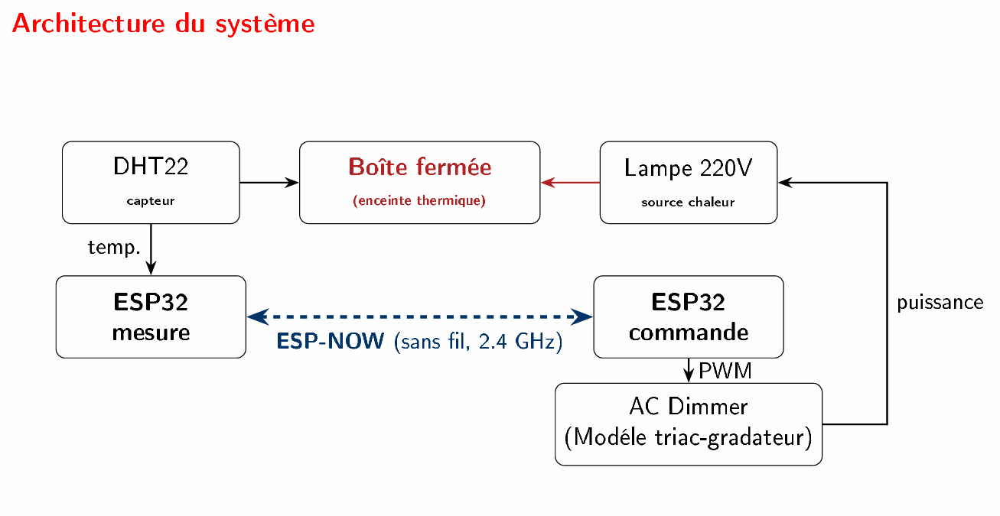
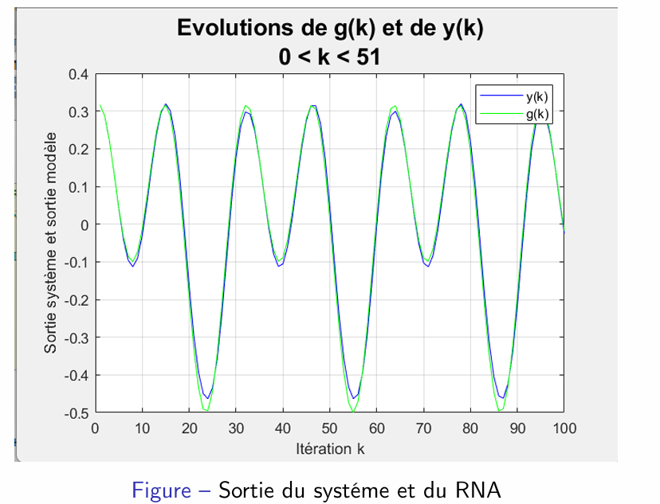
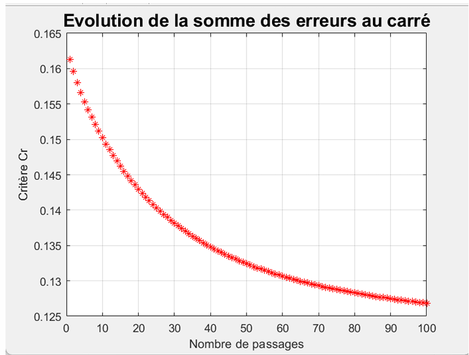
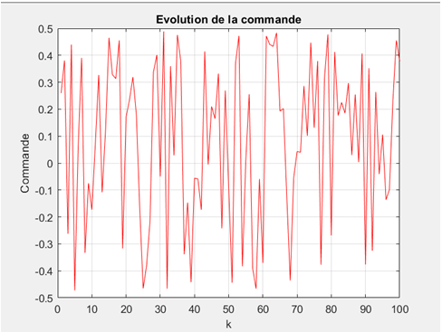
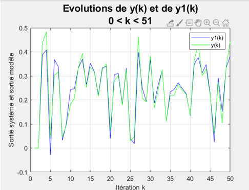
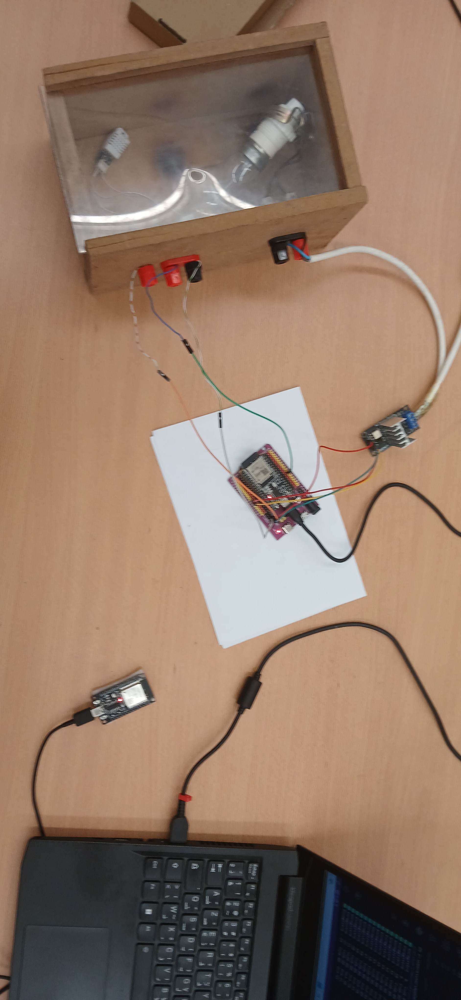
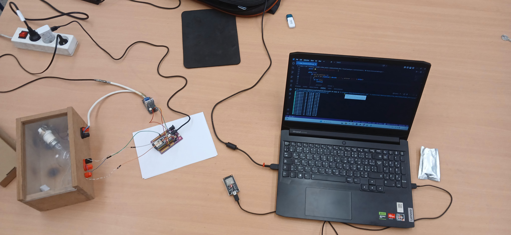
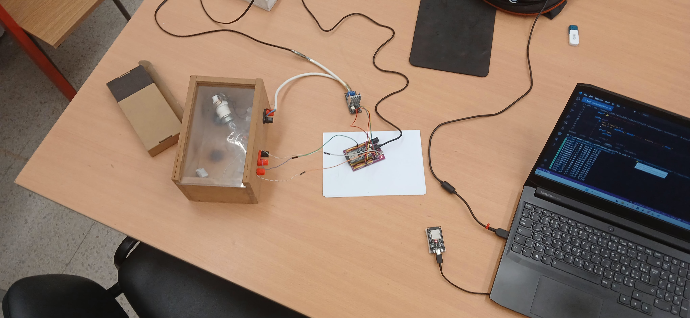
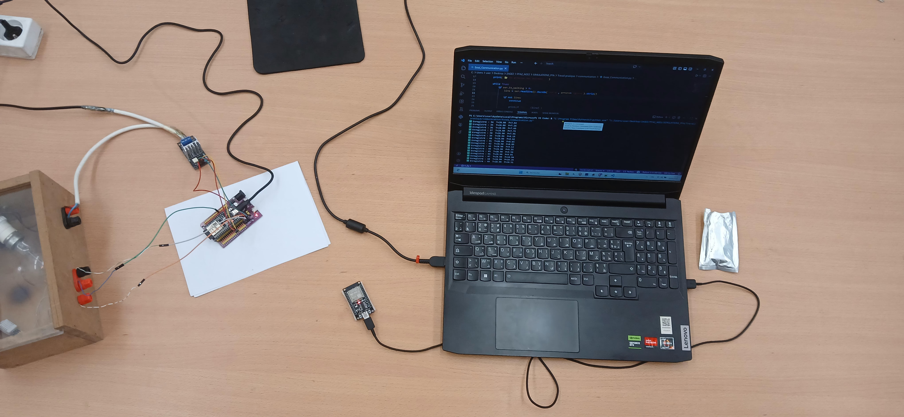

# 🚀 [Commande par réseaux de neurones artificiel d'un systéme thermique ]

> **Description succincte :** Une à deux phrases décrivant le problème résolu, les technologies clés utilisées et l'objectif principal du projet.

---

## 📌 Table des Matières
- [Présentation du Projet](#-présentation-du-projet)
- [Architecture & Contexte](#-architecture--contexte)
- [Fonctionnalités Principales](#-fonctionnalités-principales)
- [Technologies & Outils](#-technologies--outils)
- [Aperçu & Résultats](#-aperçu--résultats)
- [Installation & Utilisation](#-installation--utilisation)
- [Auteurs & Remerciements](#-auteurs--remerciements)

---

## 💡 1.Présentation du Projet
*Le projet que j'ai réalisé concentre sur l'imlémentation d'une commande par réseaux de neurones artificiel d'un systéme thermique ,on vois alors la création à la main des algorithmes d'apprentissages de test ,et de validation de la structure de commande.Pour l'implémentation de la commande on utulise la cible esp32 devkit qui englobe le mcu esp32 de espressiv un mcu à connectvité BLE,et wifi selon le standard 805.11.2,l'algorithme de commande utulise aussi une pénalité sur la variation de la commande lors du calcul du RNA,qu'on appelle "commande par minimum de vaiance" .

## 📐 2.Architecture & Contexte
Dans cette section, nous présentons la conception globale du projet ainsi que l'architecture matérielle et logicielle mise en place.
### 1. Schéma Global du Système
Le schéma ci-dessous illustre le flux de données et l'interaction entre les différents blocs du système :

### 2.fonctionnalités-principales
dans la chaine de conception ,et détude du projet on a passé par rappeler les notions de commande classiques 
,càd ceux développés sur la notion des controleurs PID ou controleur proportionel Intégrale dérivé appliqués sur un systéme de 1 ére et de deuxiéme ordre ,
on voix alors la stabilisation de la sortie de systéme ,et le suivi de la commande régulée.Dans un deuxiéme temps on applique la commande neuronale RNA sur un systéme défine discret à commande générée aléatoirement,la relation entre sa sortie ,et son entrée est de la forme y(k)=F(u(k-1),u(k-2)),dans l'algorithme d'identification du systéme on va à quel nombre de passage le réseau apprend il complétement la dynamique du systéme.
|Figure 1 | Figure 2 |
| :---: | :---: |
|  |  |
|Figure 3 | Figure4 |
| :---: | :---: |
|      |  |

## 📐 3.Architecture & Contexte

Le projet consiste en la mise en place d'une commande neuronale pour une enceinte thermique. La conception globale intègre l'interaction entre les microcontrôleurs et le système thermique à réguler.

### Schémas et Vues du Système

Voici les différentes figures illustrant le travail réalisé et la mise en place du montage :

| Vue / Étape 1 | Vue / Étape 2 |
| :---: | :---: |
|  |  |

| Vue / Étape 3 | Vue / Étape 4 |
| :---: | :---: |
|  |  |
